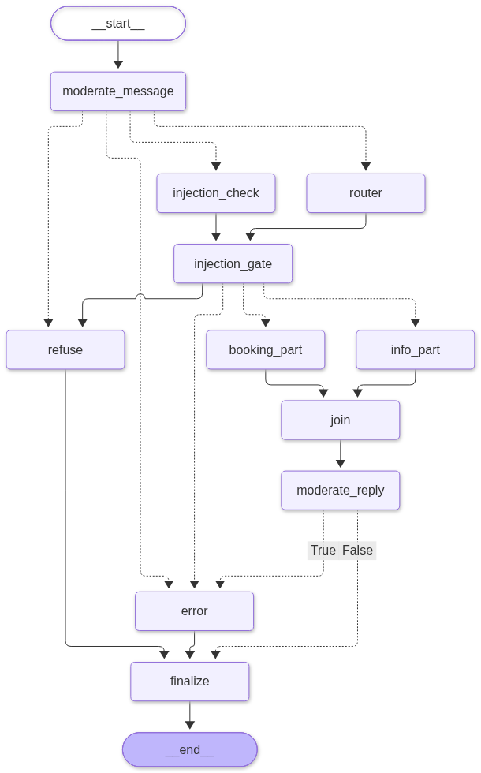

# Orchestration

The orchestration layer is a LangGraph state graph. A router LLM splits each incoming
message into parts, one per sub-agent it needs, and dispatches each part to its
sub-agent, or refuses the message if it is out of scope. Conversation history is
maintained in memory via LangGraph's `MemorySaver` checkpointer, keyed by `thread_id`.

## Routing

The router is a single LLM call driven by
[`system_prompts/orchestration.txt`](https://github.com/iannellis/Blue-Horizon-AI-Concierge/blob/main/blue_horizon/system_prompts/orchestration.txt).
It returns a `RouteDecision` holding a list of parts. Each part is a `query`, that piece
of the message restated to stand on its own, and a `step`:

| Step | Meaning |
|---|---|
| `info` | Hotel services, amenities, policies, FAQ content |
| `booking` | Room availability, pricing, and reservation changes |
| `refuse` | Out of scope, or a prompt-injection attempt |

The turn's `route` is the dispatched steps joined by `+` in the order the guest asked:
`info`, `booking`, `booking+info`, or `info+booking`. It is `refuse` when every part
was a refusal, and `error` when the router failed. Before dispatching, the router
node drops refused parts, so the legitimate half of a message that also carries an
injection is still answered, and merges parts that share a step, so the booking agent
is never dispatched twice in one turn.

Refusals never reach a sub-agent. They return `[orchestration.messages].refusal`
verbatim, so a refusal costs one LLM call rather than a full pipeline: this is why the
refuse route's p50 latency is roughly a quarter of the other two.

### The info/booking boundary is the hard part

Most of the router prompt's length exists to handle cases that look like one route and
belong to the other. A question about how many floors the hotel has reads like general
hotel information but is a booking question: no FAQ entry covers it, and the floor range
comes from the `rooms` table, which the booking agent's prompt and `search_rooms` schema
are built from. A question about modifying a reservation *without penalty*
is a policy question, not a modification request. A question about whether a chartered
yacht includes crew is a service-details lookup, not a request for the assistant to act
as crew. A request to list every room matching some criteria is a room search, not a
bulk-data request: `search_rooms` bounds its own answer, so the router has no bulk-data
rule.

These were found empirically: each one is a case in the eval dataset that misrouted,
was diagnosed, and produced either a new rule or a worked example in the prompt. Route
accuracy is measured on every eval run precisely because this boundary is where
regressions show up first. See
[Design Goals and Decisions](../design-decisions.md#routing-rules-are-earned-not-designed).

### A message that needs both agents is split

"Show me some presidential suites. What kind of room service can I get with them?"
needs the booking agent for the suites and the information agent for room service. The
router returns one part for each, and the conditional edge after it fans the parts out
with LangGraph's `Send`, so the two sub-agents run in parallel. The turn then takes as
long as the slower one, not the sum of both.

What each sub-agent receives depends on how many parts the turn has:

- **One part.** The sub-agent gets the history and the guest's message itself, not the
  router's `query`. A single-intent turn reaches its agent exactly as it did before
  splitting existed, so a restatement cannot drop a detail such as a date.
- **Several parts.** Each sub-agent gets the earlier history, then its own part's
  `query` in place of the guest's message, so neither answers, or refuses, the other
  half. The router resolves references inside the message while restating it ("them"
  becomes "the presidential suites"). A reference to an earlier turn can stay as it is,
  since the history still comes along: "Book it" after a question about room 1801
  resolves the same way it always has.

A message whose parts depend on each other ("book whichever room is closest to the
spa") is not split. It takes the single step blocking the next action, as every mixed
message did before.

The `join` node combines the parts' replies. A single part's replies are kept as the
sub-agent wrote them. Several parts' replies are joined into one message in the order
the guest asked, with no model call: a model rewriting them could misdescribe a
proposal, and the confirmation dialog the guest acts on is built from the proposal's
stored fields regardless.

## Moderation

Every guest message and every reply passes through OpenAI's moderation endpoint
(`[orchestration.moderation].model`, `omni-moderation-latest` by default), a classifier
separate from the router. Without it, whether a harmful message was refused depended
only on the router model's judgement, which a jailbreak can argue with.

- `moderate_message` is the first node of every turn. A flagged message skips the
  router and goes straight to `refuse`, so no model reads it. In history it is replaced
  with the placeholder `[Message withheld: flagged by moderation]`, so later turns do not
  send it either.
- `moderate_reply` runs after `join`, on the text of the
  turn's replies. A flagged reply is replaced with `[orchestration.messages].refusal`
  before `finalize`, and the manager invalidates any proposal the turn made, since the
  guest never read the reply that described it.
- Both set `flagged` (`"message"` or `"reply"`) in the state. The manager's turn log
  reports it as the outcome `flagged_message` or `flagged_reply`. The moderator logs one
  warning line naming the flagged categories, also attached as the
  `moderation_categories` attribute, and never the text.

A moderation call that fails fails the turn, recorded like a router failure (see
[Failed turns](#failed-turns)), rather than letting the text through unchecked. A
refusal or a failed turn is not checked, since its copy comes from config.

Moderation catches harmful content such as violence, harassment, or sexual content. It
does not catch an off-topic request or a prompt injection, which stay the router's job.

## Concurrency and timeouts

`[orchestration.orchestration]` in
[`app_config.toml`](https://github.com/iannellis/Blue-Horizon-AI-Concierge/blob/main/blue_horizon/app_config.toml)
bounds every stage:

| Setting | Default | Purpose |
|---|---|---|
| `router_timeout_s` | 30 | Wall-clock cap on the router node |
| `info_timeout_s` | 60 | Wall-clock cap on the information node |
| `booking_timeout_s` | 60 | Wall-clock cap on the booking node |
| `llm_concurrency` | 25 | Maximum concurrent pipeline executions |

`llm_concurrency` is a semaphore, not a queue limit. It exists because the stress test
drives 50 concurrent sessions against a single OpenAI account: without it, a traffic
spike exhausts the tokens-per-minute quota and every in-flight request fails together
rather than a few waiting their turn.

The timeouts bound how long a guest waits, not what a turn costs. Each model client also
caps the tokens one response may generate, with `max_output_tokens` in the router's,
information agent's, and booking agent's `llm` sections. See
[Configuration](../guides/configuration.md).

Initialization uses `tenacity` with exponential backoff between `init_retry_base_s` and
`init_retry_max_s`, so a cold Redis or a suspended Neon compute delays startup instead
of failing it. A pending wait is not cut short when a dependency comes back, so
`init_retry_max_s` (10 seconds) is also the worst-case delay between a dependency
recovering and the API becoming ready. A dependency that stays down logs its traceback
on the first failed attempt only, then one line per retry.

## Failed turns

A turn fails when the router or a sub-agent exceeds its timeout above, raises, or the
turn ends without a reply, when a moderation check fails, or when the booking agent
could not reach its database. Every
failure site records a `turn_error` of `"timeout"`, `"unavailable"`, `"quota"`, or
`"internal"` in
the graph state instead of writing a reply:

| Site | Records |
|---|---|
| Router timeout | `timeout` |
| Router exception, or the router returning no parts | `internal` |
| Sub-agent timeout (`info_timeout_s`, `booking_timeout_s`) | `timeout` |
| Sub-agent exception, including the booking agent reaching `[booking.agent].max_model_calls_per_turn` | `internal` |
| Sub-agent returned no reply | `internal` |
| Booking agent exception caused by `BookingUnavailableError`, raised by a booking tool that could not reach the database | `unavailable` |
| Booking agent returned, but a `search_rooms` result this turn carried `error_kind` `unavailable` | `unavailable` |
| Router, sub-agent, or moderation exception whose cause chain holds an `openai.APIError` with `type` or `code` `insufficient_quota` | `quota` |
| Moderation check exception, on the message or the reply | `internal` |
| No final assistant message for the turn | `internal`, set by `finalize` |

A sub-agent failure is recorded on its part, not on the turn, because whether the turn
failed depends on its other part. `join` fails the turn only when every part failed,
recording the first of `quota`, `unavailable`, `timeout`, and `internal` that any part
recorded. `quota` comes first because its copy must never invite a resend. A
single-part turn therefore fails exactly as it did before splitting.

### A turn with one failed part

When one part fails and the other succeeds, the turn is answered, not failed. `join`
puts the failed part's guest-facing copy in its place in the reply, chosen by the same
`turn_error_message` the `error` event uses, so a booking outage beside a successful
information answer still reads `[orchestration.messages].database_unavailable`.
`finalize` reports the failed steps as `failed_parts`, the turn log records the outcome
`partial`, and a failed booking part invalidates any proposal it made, since the guest
read the failure copy rather than the reply that described it. A failed information
part leaves the booking part's proposal confirmable.

`finalize` then removes the failed turn from history entirely. The manager reads
`turn_error` from `finalize`'s own output, emits an `error` event instead of `done`, and
invalidates any proposal the turn created. `moderate_message` clears `turn_error` at the
start of every turn, so a failure still held in the checkpoint from an earlier turn is
never reported again. The event's message is `[orchestration.messages].database_unavailable`
for `unavailable`, `[orchestration.messages].quota_exhausted` for `quota`, and
`[orchestration.messages].error` for the other codes.

`quota` means OpenAI refused the call because the project's spend limit or the prepaid
credit is used up. It is matched on the error body, not the `RateLimitError` class
alone, because an ordinary 429 clears on its own and stays `internal`. The router is
the first model call of every turn, so in practice it is the router that records
`quota`, unless the moderation endpoint reports it first. It is logged as one warning line carrying OpenAI's `code` (for example
`project_spend_limit_exceeded`) as the `quota_code` attribute, which is what an Axiom
monitor should alert on. The UI shows the copy without a Send again button, since a
resend fails the same way until the limit is raised.

The two `unavailable` rows cover the two ways a booking tool reports an outage.
`list_my_bookings` and the `propose_*` tools raise `BookingUnavailableError`, which
`create_agent` does not catch, so it escapes the booking agent. `search_rooms` instead returns
its outage as a result, so the second row discards a reply the agent did produce. After a database
outage the model writes its own account of it, which would reach the guest as an
ordinary answer, free to invite a retry in its own words, and without the Send again
button. The booking node reads the `error_kind` of its part's `search_rooms` results,
never the reply text, and only results since the turn's own guest message count.

A router or sub-agent exception whose cause chain contains a `BookingUnavailableError` or
a network failure (a LangChain `ModelConnectionError` or `ModelTimeoutError`, or any
`OSError` such as a failed DNS lookup) is logged as one warning line naming the root
cause. Any other exception is logged at ERROR with its full traceback.

Two things follow. A failure can no longer reach a client looking like an ordinary
reply, which is what previously kept the UI from offering its Send again button. And the
router never reads an apology in history as something the concierge said. See
[API Reference](../api.md#streaming-events) for the event shape, and
[Design Goals and Decisions](../design-decisions.md#a-failed-turn-was-reported-as-a-successful-one)
for the reasoning.

## History length

`finalize` also caps how much history a thread keeps. After dropping tool chatter and
any failed turn, it keeps only the most recent
`[orchestration.orchestration].max_history_turns` completed turns (default 10), so the
router and the sub-agent on the next turn see at most that many earlier turns plus the
new message. Every turn resends the whole history to both, so without the cap the cost
of a message grows with the length of the conversation. A failed turn is dropped before
the cap is applied, so it never pushes a completed turn out.

The cap applies to what the model sees, not to what the guest sees: the UI keeps its own
copy of the conversation and still shows every message. Bookings are unaffected, since
`list_my_bookings` reads them from the database rather than from history.

## Readiness

`OrchestrationManager` tracks a three-state `Readiness` enum, not a boolean, because
"not ready yet" and "will not become ready by itself" call for different guest-facing
copy and, for the latter, no retry affordance at all:

| State | Entered when | `/v1/chat`, `/v1/customers`, `/v1/bookings` |
|---|---|---|
| `READY` | The compiled agent is built | Served normally |
| `STARTING` | No agent yet, and the last attempt (if any) failed for a reason classified transient | `503` + `Retry-After`, `[orchestration.messages].unavailable` - no retry instruction, since recovery is expected on its own |
| `FAILED` | No agent yet, and the last attempt failed for a reason classified **permanent** | `503` + `Retry-After`, `[orchestration.messages].failed` - explicitly says this will not resolve on its own |

`is_ready` stays available as a derived `READY`-or-not property for callers (like
`/v1/health`) that only need a yes/no answer; `readiness` exposes the full state for
callers that must distinguish `STARTING` from `FAILED`.

**Classification, not the retry loop, is what changes.** The init loop keeps
`stop_never` in both non-ready states: an externally-fixed dependency (a corrected
database role, a Neon compute that finishes waking up) should recover without an
operator restart, even after being classified `FAILED` once. What differs is only the
message shown while waiting. Classification comes from the exception type the last
init attempt raised:

- `ConfigurationError` (a sibling of `OperationalError`, not a subclass, so existing
  `except OperationalError` handlers do not swallow it) marks the failure permanent and
  sets `FAILED`. Raised only from genuinely unrecoverable sites: `startup_check`'s
  read-only-role guard (see [Booking agent](booking-agent.md#1-two-database-roles)),
  a missing packaged prompt file, a missing or blank required database URL, Redis
  rejecting the credentials in `REDIS_URL`, and Postgres rejecting the password in
  either database URL. The Postgres check opens one direct connection per URL before
  the pools, because a pool retries a rejected password internally and a checkout
  only ever reports `PoolTimeout`, which looks the same as an outage. libpq gives that
  rejection no SQLSTATE, so it is matched by its message.
- Everything else - `OperationalError`, or an exception type the classifier does not
  recognise - sets `STARTING`. Defaulting an unrecognised exception to `STARTING`
  rather than `FAILED` is deliberate: a misclassification then degrades to bad copy
  (a permanent failure described as transient) rather than to a guest being told a
  transient outage will never resolve, and the process never gives up regardless.

A `/v1/chat` request is gated on `is_ready` before either content-negotiated branch
commits to a response, since a `StreamingResponse` commits its `200` as soon as it
starts and cannot become a `503` afterward. See
[API Reference](../api.md#readiness-503) for the wire-level response shape, and
[Design Goals and Decisions](../design-decisions.md#asking-the-guest-to-try-again-was-hiding-three-different-failures)
for why "please try again" was replaced by this instead of by better copy alone.

## Session isolation

Each conversation is keyed by a UUID `thread_id`. The checkpointer stores that thread's
message history and booking context, so concurrent sessions cannot see each other's
state. A `thread_id` is additionally bound to whichever `customer_id` first used it, and
the API rejects a later request that replays the same `thread_id` under a different
guest with `409 Conflict`.

### Memory use

`MemorySaver` keeps every checkpoint a thread has written, not only the latest. The
`finalize` trim shortens the newest checkpoint, but earlier ones, including that turn's
tool results, stay in memory. Memory therefore grows with every turn and is released
only when the process restarts. A measured stand-in for a booking turn with four
searches costs about 100 KB once the history window is full.

The growth is bounded rather than leaked. At most `seeded_customer_count` visitors hold
a guest at once, and each signed-in visitor may send `[chat].max_turns_per_hour` turns,
so with the defaults (100 guests, 10 turns) the ceiling is about 1,000 turns an hour, or
roughly 2.4 GB a day. The Space restart at the end of the nightly reset workflow
(`.github/workflows/nightly-reset.yml`) clears it, well inside the Space's 16 GB. A host
without that restart, or with much less memory, would need `checkpointer.delete_thread()`
when a guest claim expires, or a checkpointer that keeps only the latest checkpoint.

## Streaming

The manager translates LangGraph's internal event stream into the coarse, user-facing
stage labels the UI displays inside the assistant bubble. The full SSE protocol is
documented in the [API Reference](../api.md#streaming-events).
